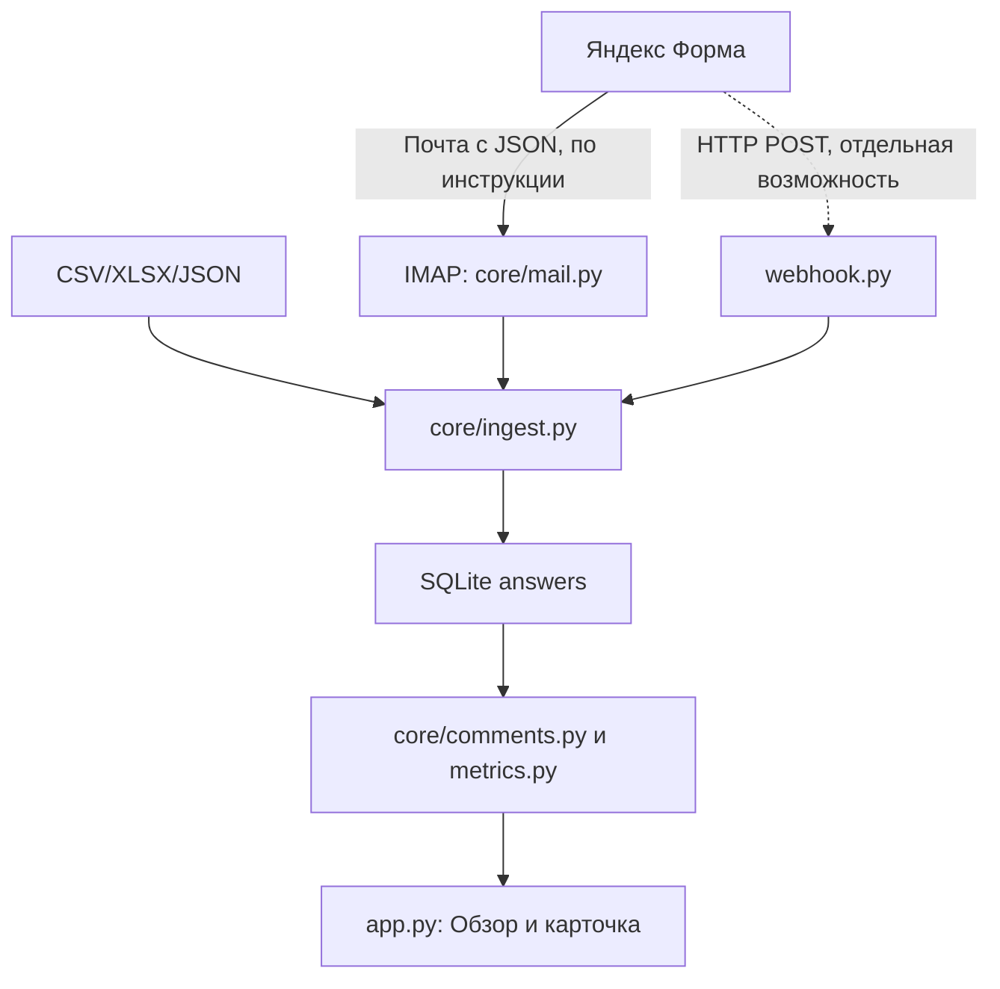

# Диагностика доставки ответа: 25 ноября 2026

**Код:** локальный коммит `3159ff713475a70885a54a64301514529aed9a3d`,
ветка `codex/final-comment-benchmark` (содержимое также вынесено в черновой PR № 1).
**Среда:** чистая временная SQLite, Python с `requirements.txt`, отдельный временный журнал;
реальных ключей, адреса почты и данных стажёров не использовали. В клоне нет `.env`.
**Запуск:** `python -m pip install -r requirements.txt`, `python -m streamlit run app.py`,
для отдельного HTTP-приёмника `python -m uvicorn webhook:app --port 8000`.
Streamlit ответил `200` на локальный `/_stcore/health`; весь набор тестов: **46 passed**.

## Текущие пути

Экран `app.py` при настройке почты вызывает `mail.fetch` примерно раз в минуту; кнопка
«Проверить почту сейчас» запускает тот же путь. `mail_seen` дедуплицирует письма по Message-ID.
`webhook.py` — альтернативный приёмник; в настройке опубликованных форм из репозитория
описана **почтовая** интеграция, но фактические переключатели у владельца форм здесь не проверены.
Прямого чтения API Яндекс Форм (OAuth, пагинация) в коде нет.

После `flatten_answer` и `to_rows` для каждого непустого ответа на вопрос вычисляется
`SHA1(role|clean_name(intern)|month|qid)`, затем `insert or replace` в `answers`.
Этот ключ одинаков для повторной передачи той же анкеты и ручного импорта, если роль,
ФИО, месяц и ID вопроса совпадают. Он **не содержит** `x-delivery-id` и текста: повтор
с иным содержимым для того же человека, месяца и вопроса перезапишет запись.
Вопросы сопоставляются по `survey/questions.csv`.

## Вход → ожидание → факт

| Вход | Ожидание | Факт |
|---|---|---|
| Синтетический POST: ФИО, месяц 2, оценка 2, комментарий и время | 2 строки в базе, текст в карточке | HTTP 200 `saved: 2`; 2 строки; дата и текст совпали; в «Обзоре» появился человек, в карточке — именно тестовый комментарий |
| Тот же POST с прежним и новым `x-delivery-id` | Нет дублей | Оба раза HTTP 200 `saved: 2`, в базе по-прежнему 2 строки. Заголовок не участвует в ключе. `saved` считает обработанные строки, не число новых |
| Только ФИО и месяц; только неизвестная колонка | Нет новых ответов | Оба запроса HTTP 400; количество строк неизменно |
| Лишняя колонка при наличии известных вопросов | Неизвестное поле сообщено отдельно | HTTP 200, имя в `unknown`; известные поля обработаны |
| Более 21 тыс. символов, кириллица, HTML-подобный текст, кавычки и emoji | Текст сохранён целиком | HTTP 200, точное совпадение текста в SQLite; сырой журнал ограничен 20 тыс. символов и не содержит полного запроса |
| Ручной CSV той же анкеты после POST | Совпадают ID, дата, текст, счётчик | Тот же `uid`, те же дата и текст; 4 строки в базе до и после импорта (включая вторую длинную запись), UI показывает 2 комментария |
| Ошибка IMAP в синтетической подмене | Отличима от неверной колонки | `ответов: 0`, ошибка подключения в поле `ошибки`; реальный сервер почты не проверялся |
| Публичная форма стажёра, синтетический ответ «Тест Диагностики Кодгорода» | Форма примет ответ | 25 ноября форма показала «Спасибо! Ответ сохранён». Доставка из формы в почту/HTTP и появление в **реальном** дашборде этим не подтверждены |

Локальный HTTP-приёмник обрабатывает JSON; фактический формат исходящего запроса Яндекса
не сверялся с журналом «Выполненные интеграции». В репозитории нет файла
`tunnel/cloudflared.exe`, на который ссылается `zapusk_priemnika.bat`. Поэтому запуск
публичного туннеля этим BAT на чистом клоне не проверен и потребует отдельной настройки.
Адрес действующего публичного HTTP-приёмника не задан: DNS AAAA, IPv6-доступ, TLS,
firewall и повторная доставка Яндексом не подтверждены. Если используется почта,
эти проверки HTTP-приёмника не являются проверками выбранного пути.

**Причина возможного сбоя реальной доставки пока неизвестна.** Следующий проверяемый шаг:
в аккаунте владельца формы посмотреть включённое действие «Почта» или «API/HTTP» и его журнал;
для почты сверить доставку синтетического письма с меткой `[intern]`, затем результат кнопки
«Проверить почту сейчас» на машине с локально настроенными учётными данными. Для HTTP
записать фактический URL и статус в «Выполненных интеграциях», затем сверить запрос с
локальным журналом и `answers.uid`. Пароли и сырые отзывы в отчёт не копировать.
